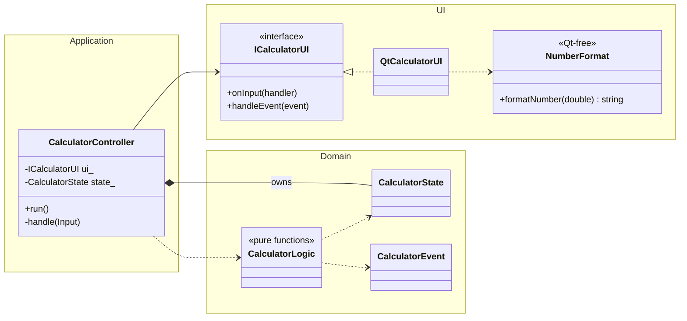
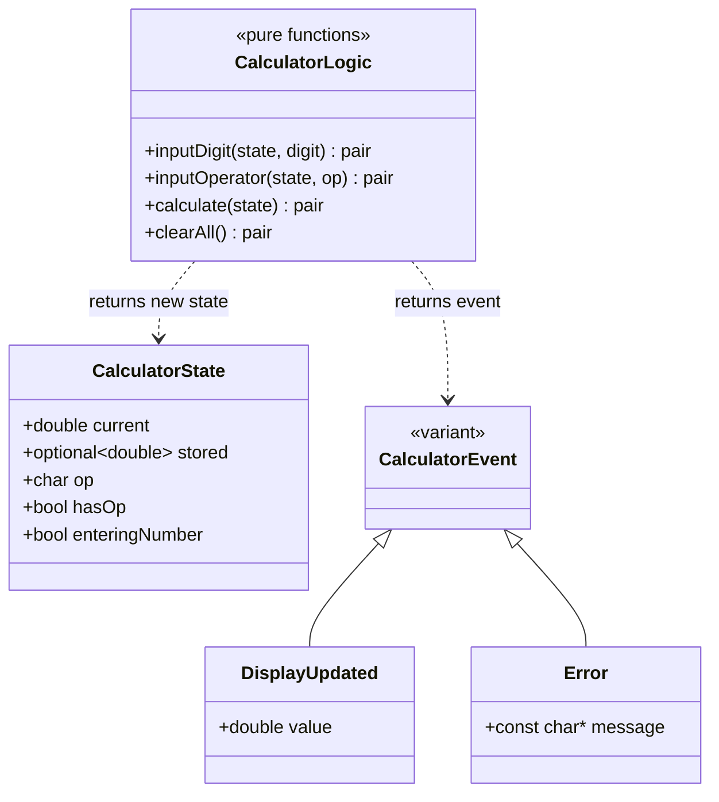
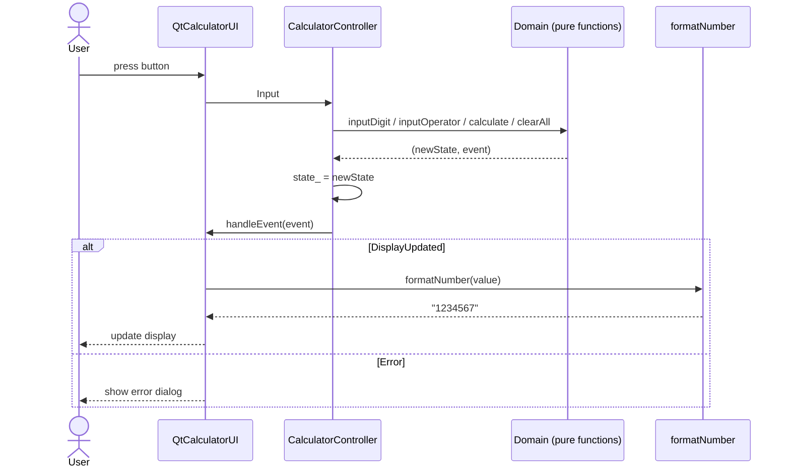

# Qt Calculator (C++17 / Qt6)

[](https://github.com/KoichiKurita/CPPlang-Calculator/actions/workflows/ci.yml)
[](https://github.com/KoichiKurita/CPPlang-Calculator/releases)
[](LICENSE)

---

## 📌 Overview

A calculator application built with **C++17 and Qt6**, designed using clean architecture principles and a pure-function domain model.

This project intentionally applies the same architectural philosophy as the [Number Guess Game](https://github.com/KoichiKurita/CPPlang-Number-Guess-Game) project, demonstrating architectural consistency across different domains.

---

## 🎯 Features

- Basic arithmetic operations: `+`, `-`, `*`, `/`
- Continuous calculation (e.g. `2 + 3 + 4 = 9`)
- Operator replacement on repeated input (e.g. `2 + * 3 = 6`)
- Clear (`C`) button
- Error handling: division by zero, overflow, invalid input
- Up to 15 significant digits displayed without exponential notation
- Event-driven Qt UI
- Domain logic completely decoupled from UI

---

## 🏗 Architecture

The project follows a layered architecture:

```text
UI (Qt)
↓
Application (Controller)
↓
Domain (Pure Functions)
```

### Architecture Diagram



- The **Domain** and **Application** layers have zero dependency on Qt.
- The Controller **owns the calculator state** for its entire lifetime.
- Display formatting (`formatNumber`) is a Qt-free pure function, so it is unit-tested as well.

---

## 🧠 Domain Model (Pure Functional Core)

The domain consists of:

- `CalculatorState`
- `CalculatorEvent` (`std::variant<DisplayUpdated, Error>`)
- Pure functions:
  - `inputDigit`
  - `inputOperator`
  - `calculate`
  - `clearAll`

### Domain Diagram



### Design Principles

- No I/O inside domain
- No framework dependencies
- Deterministic state transitions
- Every input is validated; errors are returned as events, never swallowed

---

## 🔄 Sequence Flow

When a button is pressed:

1. UI emits `Input`
2. Controller invokes domain function with the current state
3. Domain returns `(newState, Event)`
4. Controller stores `newState` and UI updates display

### Sequence Diagram



> Diagrams are written in [Mermaid](https://mermaid.js.org/) and rendered natively by GitHub, so they are versioned as text alongside the code.

---

## 🧪 Testing

Unit tests are written with **GoogleTest** (fetched via CMake `FetchContent`, pinned to a commit hash).

| Test suite | Target | What it verifies |
| --- | --- | --- |
| `CalculatorLogicTest` | Domain | Arithmetic, continuous calculation, operator replacement, error propagation, input validation, digit limit, overflow |
| `CalculatorControllerTest` | Application | State is kept after `run()` returns (uses a Qt-free `FakeUI`) |
| `NumberFormatTest` | UI (Qt-free) | 15-digit display, negative numbers, decimals, `-0` |

Because the domain and application layers are Qt-free, tests can be built **without Qt**:

```bash
cmake -S . -B build-noqt -DCALC_BUILD_GUI=OFF
cmake --build build-noqt
ctest --test-dir build-noqt --output-on-failure
```

---

## 🛡 Quality & Security

| Area | Measure |
| --- | --- |
| Input validation | Digits (0–9) and operators (`+ - * /`) are validated in the domain layer |
| Numeric safety | Input limited to 15 digits; `inf` / `NaN` results are reported as `Overflow` |
| Memory safety | Linux CI runs all tests with **AddressSanitizer** and **UndefinedBehaviorSanitizer** |
| Compiler warnings | `-Wall -Wextra -Wpedantic` (`/W4` on MSVC) applied to project targets |
| Supply chain | GoogleTest pinned by commit hash; release zip published with **SHA256 checksum** |
| CI permissions | Least privilege (`contents: read`); write permission only for the release job |

---

## 📂 Project Structure

```text
CPPlang-Calculator/
├─ src/
│  ├─ domain/        # Pure logic (header-only, Qt-free)
│  ├─ app/           # Controller (Qt-free)
│  ├─ ui/            # Qt UI + Qt-free number formatter
│  └─ main.cpp
├─ test/             # GoogleTest unit tests
├─ .github/
│  ├─ workflows/ci.yml
│  ├─ ISSUE_TEMPLATE/
│  └─ pull_request_template.md
├─ CHANGELOG.md
└─ LICENSE
```

---

## ⚙️ Build (Windows + MSYS2 UCRT64)

### Requirements

- MSYS2 (UCRT64 environment)
- `mingw-w64-ucrt-x86_64-gcc`
- `mingw-w64-ucrt-x86_64-cmake` (3.24 or later)
- `mingw-w64-ucrt-x86_64-ninja`
- `mingw-w64-ucrt-x86_64-qt6-base`
- `git` (used by CMake to fetch GoogleTest)

```bash
pacman -S --needed mingw-w64-ucrt-x86_64-{gcc,cmake,ninja,qt6-base} git
```

### Build & Test

```bash
cmake -S . -B build -G Ninja
cmake --build build
ctest --test-dir build --output-on-failure
```

### Run

```bash
./build/src/QtCalculator.exe
```

### CMake Options

| Option | Default | Description |
| --- | --- | --- |
| `CALC_BUILD_GUI` | `ON` | Build the Qt GUI application |
| `CALC_BUILD_TESTS` | `ON` | Build unit tests |

---

## 📦 Download

Download `QtCalculator-windows-x64.zip` from the [Releases](https://github.com/KoichiKurita/CPPlang-Calculator/releases) page.
The zip includes all required Qt / MinGW DLLs, so **no Qt installation is needed**.

Verify the download with the published checksum (PowerShell):

```powershell
Get-FileHash .\QtCalculator-windows-x64.zip -Algorithm SHA256
# Compare with QtCalculator-windows-x64.zip.sha256
```

---

## 🚀 CI & Release

GitHub Actions (`.github/workflows/ci.yml`):

| Job | Runner | Description |
| --- | --- | --- |
| `linux-test` | Ubuntu | Qt-free build, all tests with ASan / UBSan |
| `windows-build` | Windows (MSYS2 UCRT64) | GUI build, tests, packaging with `windeployqt` + dependent DLLs, SHA256 |
| `release` | Ubuntu | On tag push (`v*`): creates a GitHub Release with the zip and checksum |

Release example:

```bash
git tag -a v1.1.0 -m "v1.1.0"
git push origin v1.1.0
```

---

## 🌿 Development Workflow

- `main`: release branch (tagged), `develop`: integration branch
- Short-lived topic branches (`fix/`, `test/`, `ci/`, `docs/`, `chore/`) are merged into `develop` via pull requests
- Branch rulesets require pull requests and passing CI (`linux-test`, `windows-build`)
- Commit messages follow [Conventional Commits](https://www.conventionalcommits.org/)
- Changes are recorded in [CHANGELOG.md](CHANGELOG.md)

---

## 📊 Architectural Consistency

This calculator shares the same architectural philosophy as the [Number Guess Game](https://github.com/KoichiKurita/CPPlang-Number-Guess-Game) project:

| Aspect           | Calculator | Number Guess Game |
| ---------------- | ---------- | ----------------- |
| Pure Domain      | ✅          | ✅                 |
| Variant Events   | ✅          | ✅                 |
| Clean Separation | ✅          | ✅                 |
| CI/CD            | ✅          | ✅                 |

---

## 🧩 Design Evolution

1. Basic OOP structure
2. Event-driven model using `std::variant`
3. Pure-function domain refactor
4. Qt UI fully decoupled
5. **v1.1.0 — Quality improvements**
   - Fixed a dangling reference in the controller (state is now owned by the controller)
   - Fixed domain bugs (operator replacement, error propagation) and added input validation
   - Introduced GoogleTest, sanitizer-enabled CI, and a self-contained release package

See [CHANGELOG.md](CHANGELOG.md) for details.

---

## 🤖 Development Note

This project was developed with the assistance of AI tools for architectural exploration, code review, and debugging support.
All integration, configuration, debugging, and validation were performed by the author.

---

## 📜 License

This project is licensed under the [MIT License](LICENSE).
