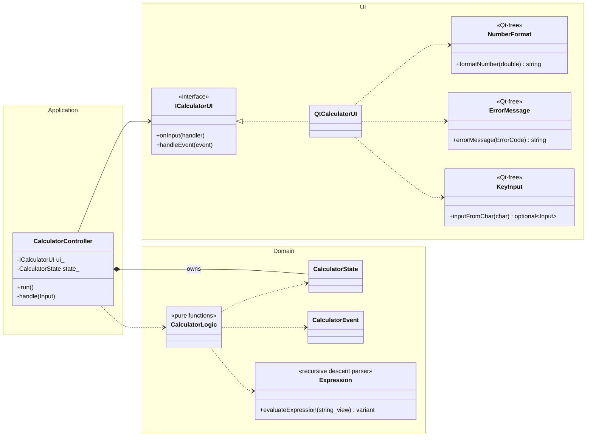
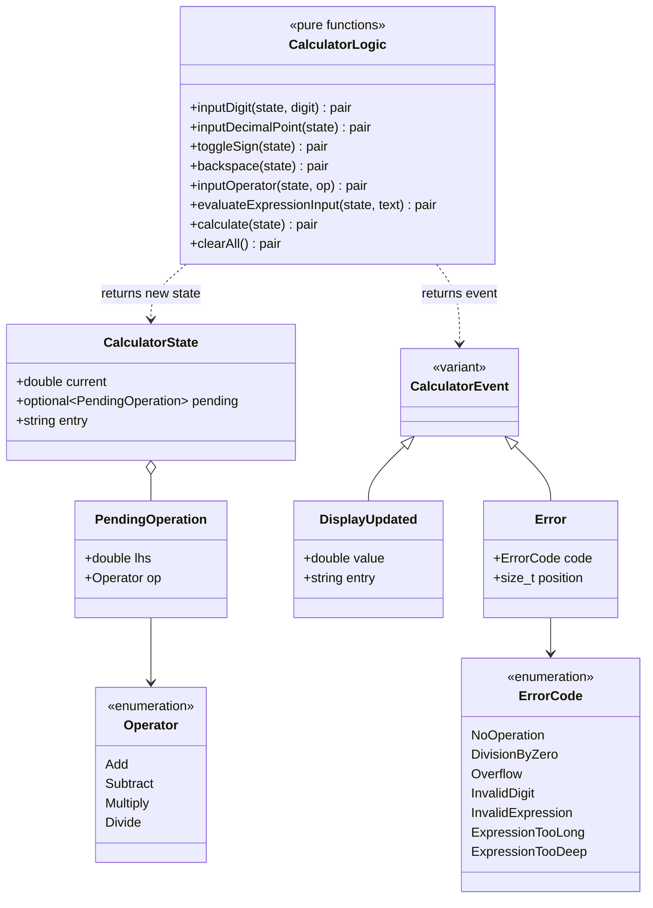
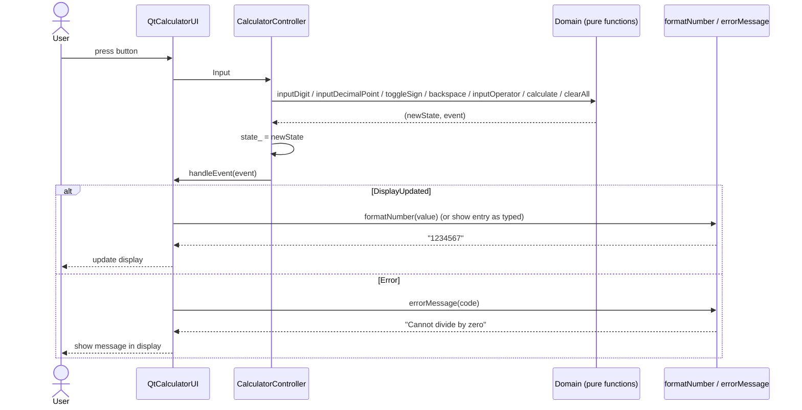

# Qt Calculator (C++17 / Qt6)

[](https://github.com/KoichiKurita/CPPlang-Calculator/actions/workflows/ci.yml)
[](https://github.com/KoichiKurita/CPPlang-Calculator/releases)
[](https://koichikurita.github.io/CPPlang-Calculator/)
[](LICENSE)

---

## 📌 Overview

A calculator application built with **C++17 and Qt6**, designed using clean architecture principles and a pure-function domain model.
It is built, tested and released for **Windows, Linux and macOS**.

This project intentionally applies the same architectural philosophy as the [Number Guess Game](https://github.com/KoichiKurita/CPPlang-Number-Guess-Game) project, demonstrating architectural consistency across different domains.

---

## 🎯 Features

- Basic arithmetic operations: `+`, `-`, `*`, `/`
- **Expression input** with parentheses and operator precedence, e.g. `(1+2)*3` (see [Expression Input](#-expression-input))
- Decimal input (`.`), sign toggle (`±`), and backspace (`⌫`)
- Keyboard input (see [Keyboard Shortcuts](#-keyboard-shortcuts))
- Continuous calculation (e.g. `2 + 3 + 4 = 9`)
- Operator replacement on repeated input (e.g. `2 + * 3 = 6`)
- Clear (`C`) button
- Error handling: division by zero, overflow, invalid input — shown in the display (no modal dialogs)
- Up to 15 significant digits displayed without exponential notation (e.g. `0.1 + 0.2` is shown as `0.3`)
- Event-driven Qt UI
- Domain logic completely decoupled from UI

---

## ⌨️ Keyboard Shortcuts

| Key | Action |
| --- | --- |
| `0`–`9` | Digit |
| `.` | Decimal point |
| `+` `-` `*` `/` | Operator |
| `Enter` / `=` | Calculate |
| `Backspace` | Delete last character |
| `Esc` | Clear |

`±` is available as a button.

---

## 🧮 Expression Input

Type an expression in the input field at the top and press `Enter`. The result is shown in the display and can be used in the next calculation.

The evaluator is a **hand-written recursive descent parser** (`src/domain/Expression.h`, Qt-free). No external evaluator (`eval`, shell, scripting engine) is used.

```text
expression = term , { ("+" | "-") , term } ;
term       = factor , { ("*" | "/") , factor } ;
factor     = ("+" | "-") , factor | primary ;
primary    = number | "(" , expression , ")" ;
number     = digits , [ "." , [ digits ] ] | "." , digits ;
```

The input is treated as **untrusted data**:

| Measure | Detail |
| --- | --- |
| Length limit | Up to 256 characters (`ExpressionTooLong`) |
| Nesting limit | Up to 64 nested parentheses / unary operators, preventing stack exhaustion by recursion (`ExpressionTooDeep`) |
| Character whitelist | Only digits, `.`, `+ - * /`, parentheses and whitespace (`Syntax error at N`) |
| Arithmetic errors | Division by zero and overflow are reported, never shown as `inf` / `NaN` |
| Fuzzing | The evaluator is fuzzed with **libFuzzer + ASan + UBSan** in CI |

| Input | Result |
| --- | --- |
| `(1+2)*3` | `9` |
| `2+3*4` | `14` |
| `-(2+3)` | `-5` |
| `1/(2-2)` | `Cannot divide by zero` |
| `2*(3+` | `Syntax error at 6` |

---

## 🏗 Architecture

The project follows a layered architecture:

```text
UI (Qt)
↓
Application (Controller)
↓
Domain (Pure Functions)
```

### Architecture Diagram



- The **Domain** and **Application** layers have zero dependency on Qt.
- The Controller **owns the calculator state** for its entire lifetime.
- Display formatting (`formatNumber`), error messages (`errorMessage`) and key mapping (`inputFromChar`) are Qt-free pure functions, so they are unit-tested as well.

---

## 🧠 Domain Model (Pure Functional Core)

The domain consists of:

- `CalculatorState` with an optional `PendingOperation` (left operand + `Operator`)
- `Operator` / `ErrorCode` (`enum class`)
- `CalculatorEvent` (`std::variant<DisplayUpdated, Error>`)
- Pure functions:
  - `inputDigit`, `inputDecimalPoint`, `toggleSign`, `backspace`
  - `inputOperator`
  - `calculate`
  - `clearAll`

### Domain Diagram



### Design Principles

- No I/O inside domain
- No framework dependencies
- Deterministic state transitions
- Every input is validated; errors are returned as events, never swallowed
- The number being typed is kept as a **string** (`entry`), so input such as `0.` or `1.50` is displayed exactly as typed and no floating-point error accumulates during input
- **Invalid states are unrepresentable**: the left operand and operator exist only together (`std::optional<PendingOperation>`), and operators / errors are `enum class` values instead of `char` / strings

---

## 🔄 Sequence Flow

When a button is pressed:

1. UI emits `Input` (button click or key press)
2. Controller invokes domain function with the current state
3. Domain returns `(newState, Event)`
4. Controller stores `newState` and UI updates display

### Sequence Diagram



> Diagrams are written in [Mermaid](https://mermaid.js.org/) and rendered natively by GitHub, so they are versioned as text alongside the code.

---

## 🧪 Testing

Unit tests are written with **GoogleTest** (fetched via CMake `FetchContent`, pinned to a commit hash).

| Test suite | Target | What it verifies |
| --- | --- | --- |
| `CalculatorLogicTest` | Domain | Four arithmetic operations, continuous calculation, operator replacement, decimal input, sign toggle, backspace, error codes and propagation, input validation, digit limit, overflow |
| `CalculatorControllerTest` | Application | State is kept after `run()` returns, clear, error replaced by next input, `12.5 * -2 = -25`, backspace (uses a Qt-free `FakeUI`) |
| `NumberFormatTest` | UI (Qt-free) | 15-digit display, negative numbers, decimals, `-0`, `0.1 + 0.2` shown as `0.3` |
| `ErrorMessageTest` | UI (Qt-free) | A message for every `ErrorCode` |
| `KeyInputTest` | UI (Qt-free) | Mapping of keyboard characters to `Input` |
| `ExpressionTest` | Domain | Precedence, associativity, parentheses, unary operators, syntax errors with positions, length / nesting limits, overflow |
| `QtCalculatorUITest` | UI (Qt, offscreen) | Real Qt widgets driven with **QTest**: button clicks, keyboard input, expression input, display of decimals and errors |

Because the domain and application layers are Qt-free, tests can be built **without Qt**:

```bash
cmake -S . -B build-noqt -DCALC_BUILD_GUI=OFF
cmake --build build-noqt
ctest --test-dir build-noqt --output-on-failure
```

### Fuzzing

The expression evaluator is fuzzed with **libFuzzer** (`fuzz/ExpressionFuzzer.cpp`) together with AddressSanitizer and UndefinedBehaviorSanitizer.
The fuzzer also checks invariants: a successful result is always finite, and an error position never exceeds the input limit.

```bash
# Clang is required
cmake -S . -B build-fuzz -DCALC_BUILD_GUI=OFF -DCALC_BUILD_TESTS=OFF -DCALC_BUILD_FUZZERS=ON -DCMAKE_CXX_COMPILER=clang++
cmake --build build-fuzz
mkdir -p corpus
./build-fuzz/fuzz/ExpressionFuzzer corpus fuzz/corpus -dict=fuzz/expression.dict -max_len=512 -max_total_time=60
```

### Coverage

Coverage is measured with **gcov / [gcovr](https://gcovr.com/)** in CI (`coverage` job).
The job fails if line coverage drops below **95%** or branch coverage below **90%**.
The HTML report for the latest release is published to [GitHub Pages](https://koichikurita.github.io/CPPlang-Calculator/).

Measure locally:

```bash
python -m venv ~/.venv-gcovr && ~/.venv-gcovr/bin/pip install gcovr==8.8

cmake -S . -B build-cov -G Ninja -DCALC_BUILD_GUI=OFF -DCMAKE_BUILD_TYPE=Debug -DCALC_ENABLE_COVERAGE=ON
cmake --build build-cov
find build-cov -name '*.gcda' -delete
ctest --test-dir build-cov
~/.venv-gcovr/bin/gcovr --root . --filter 'src/' --object-directory build-cov \
  --exclude-unreachable-branches --exclude-throw-branches --print-summary
```

---

## 🛡 Quality & Security

| Area | Measure |
| --- | --- |
| Input validation | Digits (0–9) and operators (`+ - * /`) are validated in the domain layer |
| Expression input | Treated as untrusted: length / nesting limits, character whitelist, no external evaluator; fuzzed with libFuzzer |
| Numeric safety | Input limited to 15 digits; `inf` / `NaN` results are reported as `Overflow` |
| Memory safety | Linux CI runs all tests with **AddressSanitizer** and **UndefinedBehaviorSanitizer** |
| Compiler warnings | `-Wall -Wextra -Wpedantic` (`/W4` on MSVC) applied to project targets |
| Supply chain | GoogleTest and all GitHub Actions pinned by commit SHA; Actions kept up to date by **Dependabot**; release zip published with **SHA256 checksum** |
| Binary hardening | Stack protector, `_FORTIFY_SOURCE=2`, `_GLIBCXX_ASSERTIONS`; ASLR / DEP on Windows (verified in CI), PIE / Full RELRO on Linux |
| Vulnerability reporting | Private vulnerability reporting via GitHub (see [SECURITY.md](SECURITY.md)) |
| CI permissions | Least privilege (`contents: read`); write permission only for the release job; checkout without persisted credentials |
| Code style | `clang-format` (`.clang-format`), checked in CI |
| Static analysis | `clang-tidy` (`.clang-tidy`) and `cppcheck`; findings are treated as errors |

---

## 📂 Project Structure

```text
CPPlang-Calculator/
├─ src/
│  ├─ domain/        # Pure logic (header-only, Qt-free)
│  ├─ app/           # Controller (Qt-free)
│  ├─ ui/            # Qt UI + Qt-free number formatter
│  └─ main.cpp
├─ test/             # GoogleTest unit tests + QTest GUI tests
├─ fuzz/             # libFuzzer target, seed corpus and dictionary
├─ packaging/linux/  # Desktop entry and icon for the AppImage
├─ .github/
│  ├─ workflows/ci.yml
│  ├─ dependabot.yml
│  ├─ ISSUE_TEMPLATE/
│  └─ pull_request_template.md
├─ CHANGELOG.md
├─ SECURITY.md
└─ LICENSE
```

---

## ⚙️ Build

### Windows (MSYS2 UCRT64)


- MSYS2 (UCRT64 environment)
- `mingw-w64-ucrt-x86_64-gcc`
- `mingw-w64-ucrt-x86_64-cmake` (3.24 or later)
- `mingw-w64-ucrt-x86_64-ninja`
- `mingw-w64-ucrt-x86_64-qt6-base`
- `git` (used by CMake to fetch GoogleTest)

```bash
pacman -S --needed mingw-w64-ucrt-x86_64-{gcc,cmake,ninja,qt6-base} git
```

### Linux (Ubuntu 24.04)

```bash
sudo apt-get install qt6-base-dev qt6-base-dev-tools qt6-qpa-plugins libgl1-mesa-dev cmake ninja-build git
```

### macOS (Homebrew)

```bash
brew install qt cmake ninja
# configure with: -DCMAKE_PREFIX_PATH="$(brew --prefix qt)"
```

### Build & Test

```bash
cmake -S . -B build -G Ninja
cmake --build build
ctest --test-dir build --output-on-failure
```

GUI tests run without a display (`QT_QPA_PLATFORM=offscreen` is used automatically).

### Run

```bash
./build/src/QtCalculator.exe                               # Windows
./build/src/QtCalculator                                   # Linux
open ./build/src/QtCalculator.app                          # macOS
./build/src/QtCalculator --smoke-test                      # start and exit immediately (used in CI)
```

### CMake Options

| Option | Default | Description |
| --- | --- | --- |
| `CALC_BUILD_GUI` | `ON` | Build the Qt GUI application |
| `CALC_BUILD_TESTS` | `ON` | Build unit tests |
| `CALC_ENABLE_COVERAGE` | `OFF` | Instrument code for coverage measurement (GCC) |
| `CALC_BUILD_FUZZERS` | `OFF` | Build libFuzzer targets (Clang only) |

### Code Style & Static Analysis

```bash
pacman -S --needed mingw-w64-ucrt-x86_64-clang-tools-extra mingw-w64-ucrt-x86_64-cppcheck

# Format
git ls-files 'src/*.cpp' 'src/*.h' 'test/*.cpp' | xargs clang-format -i

# cppcheck
cppcheck --enable=warning,style,performance,portability --std=c++17 --language=c++ \
  -I src --library=qt --inline-suppr --suppress=missingIncludeSystem src test
```

clang-tidy runs in CI (`static-analysis` job).

CI pins **clang-format 23.1.3** (installed from PyPI) so that formatting results match the local MSYS2 version (23.x).
Different clang-format versions can format the same code differently (e.g. alignment of trailing comments containing non-ASCII text),
so keep the local major version in sync with the CI version.
---

## 📦 Download

Download the package for your OS from the [Releases](https://github.com/KoichiKurita/CPPlang-Calculator/releases) page.
Every package bundles the required Qt libraries, so **no Qt installation is needed**.

| OS | File | How to run |
| --- | --- | --- |
| Windows (x64) | `QtCalculator-windows-x64.zip` | Extract and run `QtCalculator.exe` |
| Linux (x86_64) | `QtCalculator-linux-x86_64.AppImage` | `chmod +x` and run (requires glibc 2.39+, e.g. Ubuntu 24.04 or later) |
| macOS (Apple Silicon) | `QtCalculator-macos-arm64.dmg` | Open the dmg and drag `QtCalculator.app` to Applications |

The macOS app is **not notarized** (ad-hoc signed only). On first launch, right-click the app and choose **Open**,
or remove the quarantine attribute: `xattr -dr com.apple.quarantine /Applications/QtCalculator.app`

Verify the download with the published checksum:

```bash
# Windows (PowerShell)
Get-FileHash .\QtCalculator-windows-x64.zip -Algorithm SHA256
# Linux
sha256sum -c QtCalculator-linux-x86_64.AppImage.sha256
# macOS
shasum -a 256 -c QtCalculator-macos-arm64.dmg.sha256
```

---

## 🚀 CI & Release

GitHub Actions (`.github/workflows/ci.yml`):

| Job | Runner | Description |
| --- | --- | --- |
| `linux-test` | Ubuntu | Qt-free build, all tests with ASan / UBSan |
| `coverage` | Ubuntu | Coverage with gcovr (fails below 95% lines / 90% branches); report in job summary |
| `deploy-coverage` | Ubuntu | On push to `main`: publishes the HTML coverage report and badge to GitHub Pages |
| `windows-build` | Windows (MSYS2 UCRT64) | GUI build, tests, ASLR / DEP verification, packaging with `windeployqt` + dependent DLLs, SHA256 |
| `fuzz` | Ubuntu 24.04 | libFuzzer + ASan + UBSan on the expression evaluator for 60 seconds; crash inputs are uploaded |
| `linux-gui` | Ubuntu 24.04 | GUI build, unit + GUI tests, AppImage via linuxdeploy (tools pinned and SHA256-verified), smoke test |
| `macos` | macOS 15 (Apple Silicon) | GUI build, unit + GUI tests, `.app` via macdeployqt (ad-hoc signed), `.dmg`, smoke test |
| `release` | Ubuntu | On tag push (`v*`): creates a GitHub Release with the packages for all three OSes and their checksums |
| `static-analysis` | Ubuntu | clang-format check, clang-tidy, cppcheck |

Release example:

```bash
git tag -a v1.4.0 -m "v1.4.0"
git push origin v1.4.0
```

---

## 🌿 Development Workflow

- `main`: release branch (tagged), `develop`: integration branch
- Short-lived topic branches (`fix/`, `test/`, `ci/`, `docs/`, `chore/`) are merged into `develop` via pull requests
- Commit messages follow [Conventional Commits](https://www.conventionalcommits.org/)
- Changes are recorded in [CHANGELOG.md](CHANGELOG.md)
- Branch rulesets require pull requests and passing CI (`linux-test`, `static-analysis`, `coverage`, `fuzz`, `windows-build`, `linux-gui`, `macos`)

---

## 📊 Architectural Consistency

This calculator shares the same architectural philosophy as the [Number Guess Game](https://github.com/KoichiKurita/CPPlang-Number-Guess-Game) project:

| Aspect           | Calculator | Number Guess Game |
| ---------------- | ---------- | ----------------- |
| Pure Domain      | ✅          | ✅                 |
| Variant Events   | ✅          | ✅                 |
| Clean Separation | ✅          | ✅                 |
| CI/CD            | ✅          | ✅                 |

---

## 🧩 Design Evolution

1. Basic OOP structure
2. Event-driven model using `std::variant`
3. Pure-function domain refactor
4. Qt UI fully decoupled
5. **v1.1.0 — Quality improvements**
   - Fixed a dangling reference in the controller (state is now owned by the controller)
   - Fixed domain bugs (operator replacement, error propagation) and added input validation
   - Introduced GoogleTest, sanitizer-enabled CI, and a self-contained release package
6. **v1.2.0 — Quality, security and design**
   - Static analysis (clang-format / clang-tidy / cppcheck), coverage with GitHub Pages
   - Actions pinned by SHA, Dependabot, hardened binaries, SECURITY.md
   - Type-safe state (`PendingOperation`, `Operator`, `ErrorCode`); errors shown in the display
7. **v1.3.0 — Features**: decimal input, sign toggle, backspace, keyboard input
8. **v1.4.0 — Multi-platform**: Linux (AppImage) and macOS (.dmg) builds and releases, QTest GUI tests
9. **v1.5.0 — Expression input**: hand-written recursive descent parser with resource limits, fuzzed with libFuzzer

See [CHANGELOG.md](CHANGELOG.md) for details.

---

## 🤖 Development Note

This project was developed with the assistance of AI tools for architectural exploration, code review, and debugging support.
All integration, configuration, debugging, and validation were performed by the author.

---

## 📜 License

This project is licensed under the [MIT License](LICENSE).
